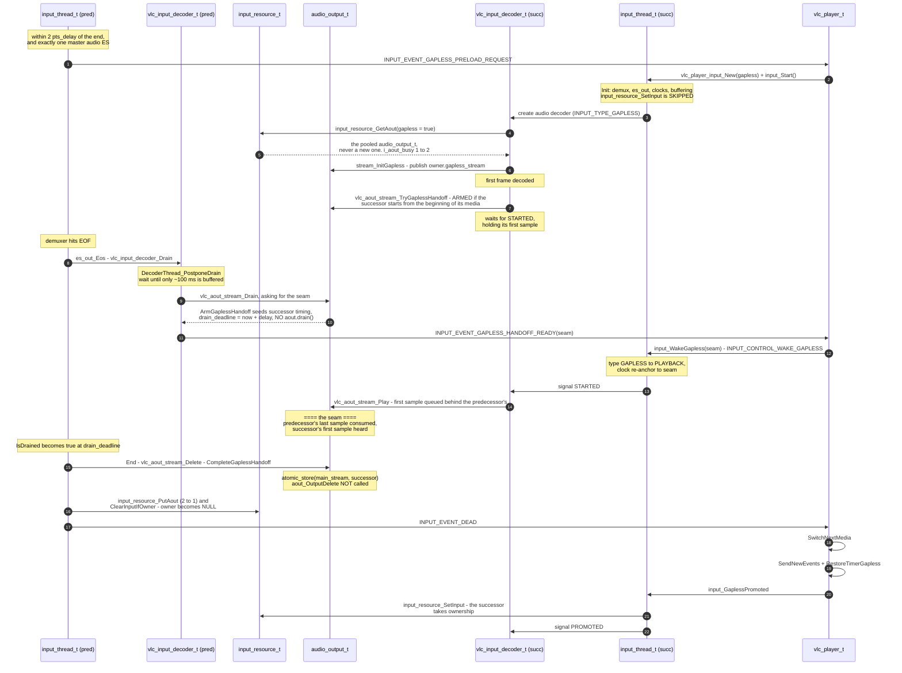
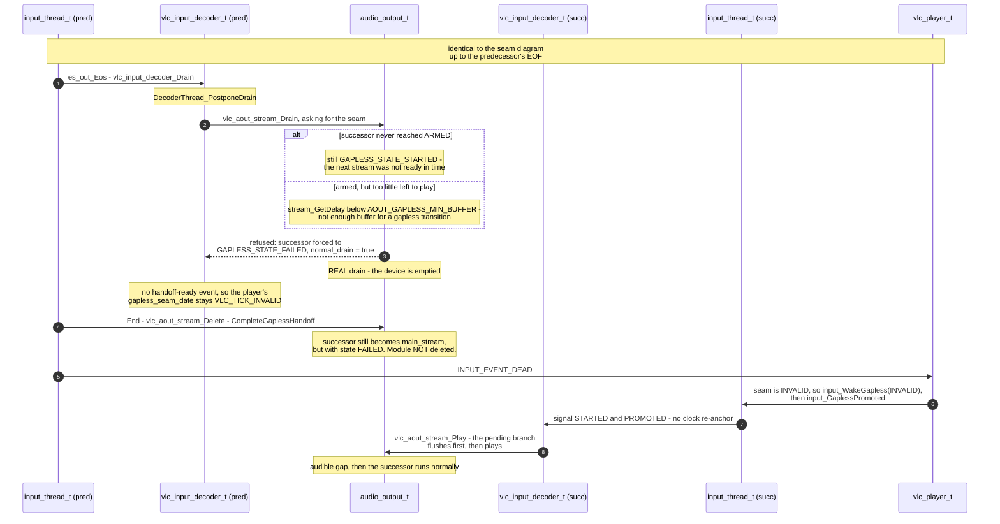
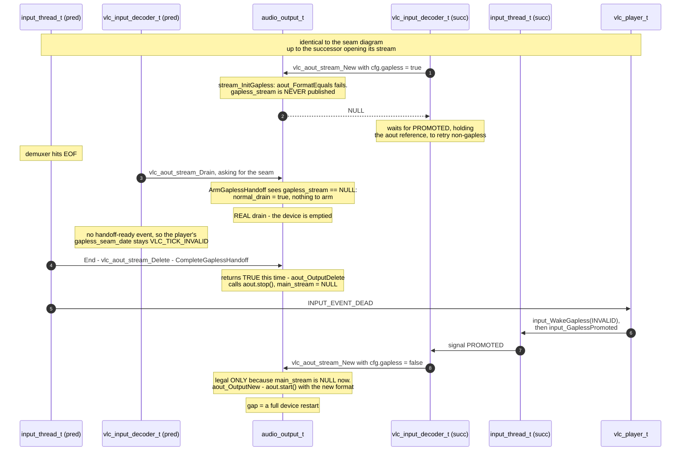

# Gapless playback

Gapless playback starts the next media without stopping or restarting the audio
output. The predecessor's last sample and the successor's first sample are
queued back to back on the same running device.

This requires two media pipelines during the transition. Each media keeps its
own input, decoders, clocks and audio stream. Only the player, input resource
and audio output are shared.

## Architecture

| Shared during a transition | One per media |
|---|---|
| `vlc_player_t` | `struct vlc_player_input` |
| `input_resource_t` | `input_thread_t` and `es_out_t` |
| `audio_output_t` | program and input clocks |
| | `vlc_input_decoder_t` |
| | `vlc_aout_stream` |

The predecessor is `player->input`. The preloaded successor is
`player->next_input`. Both use the same `player->resource`, so their audio
decoders can use the same pooled `audio_output_t`.

`audio_output_t` is the device and output module. `vlc_aout_stream` is the
per-media pipeline feeding it, with its own clock, filters, gain and timestamp
state. `aout_owner_t` tracks both streams:

```c
vlc_aout_stream *_Atomic main_stream;
vlc_aout_stream *gapless_stream;
```

`main_stream` is the predecessor until it is destroyed.
`gapless_stream` is the successor prepared for the transition. It may call
`aout->play()` only after the predecessor enters its drain path and releases
`STARTED`. Only `main_stream` may flush, drain or start a discontinuity.

The two inputs never share clocks. The successor creates and buffers against its
own clocks before the transition. Its input clock origin is shifted when the
successor starts.

## Eligibility and preload

`EsOutGaplessEventTimeChanged()` requests a preload when all of these conditions
are met:

- the current input is an `INPUT_TYPE_PLAYBACK`;
- the input is paced and has no stream output;
- valid time and length are available, with at most twice `i_pts_delay`
  remaining;
- exactly one ES is selected, it is audio, and its program clock uses it as the
  master.

The player also requires gapless to be enabled, a next media to exist, no
renderer, no successor already loaded and no earlier preload failure for the
current media.

The successor is created as an `INPUT_TYPE_GAPLESS` input against the same
resource and starts immediately. It demuxes and decodes, but remains hidden:

- it does not become the input resource owner;
- its video and subpicture outputs open only at promotion;
- player events are suppressed or stored until promotion;
- its first playable audio block waits before reaching the device.

At promotion, `vlc_player_SendNewEvents()` sends the successor's current state.

The successor obtains the existing pooled output with
`input_resource_GetAout(resource, true)`. This call never creates an output.
`stream_InitGapless()` then requires a healthy predecessor and a compatible
input format. It builds a separate filter pipeline and publishes the
new stream as `gapless_stream`; it does not call `aout_OutputNew()`.

The first block that will actually be played calls
`vlc_aout_stream_TryGaplessHandoff()`. The block must start at the beginning of
the successor media. On success the stream becomes armed and waits with that
block.

## Input status

The successor uses three independent input-level status bits:

| Status | Successful handoff | Allows |
|---|---|---|
| `STARTED` | after the predecessor starts draining, but before the seam | queue successor audio behind the predecessor |
| `PROMOTED` | after the seam, once the predecessor is fully stopped | own the resource, act as `main_stream`, open the vout and spu, drain |
| `ABORTED` | instead of any remaining milestone | release all waiters with an error and drop the held first sample |

Between `STARTED` and `PROMOTED`, successor audio is already queued on the
device, but the predecessor is still the current input and the resource owner.

## Successful transition



The predecessor first drains its filters into the output, then measures how much
audio the device still has queued. Arming requires a ready successor and at
least `AOUT_GAPLESS_MIN_BUFFER` (50 ms) of remaining delay.

The seam is calculated as `vlc_tick_now() + delay`: the absolute system date at
which the predecessor's queued audio should end. The same date becomes the
predecessor's `drain_deadline` and seeds the successor's timing. The predecessor
keeps playing, the successor is woken and queues its first block behind it, and
`vlc_aout_stream_IsDrained()` reports the predecessor drained only once that
deadline is reached.

This avoids `aout->drain()`, which would put the output in the drained state and
require a flush before another `play()`. The successful path instead keeps the
device queue active across the seam.

The clock is shifted before `STARTED`. Destruction of the predecessor swaps
`main_stream` without calling `aout_OutputDelete()`, then player-side promotion
releases `PROMOTED`.

## Clock and timing reports

The seam is `vlc_tick_now()` plus the predecessor's `stream_GetDelay()`. Two
mechanisms derive from it. Only the second decides where the successor's audio
is heard.

The successor records its buffering duration when buffering completes. At the
handoff, its input clock origin is shifted with:

```c
input_clock_ChangeSystemOrigin(input_clock,
                               seam - gapless_buffering_duration);
```

This is a shift, not a clock reset: the same formula used when buffering
completes, with the date the successor happened to finish buffering replaced by
the real seam. It moves the reference that `input_clock_GetWakeup()` reads, so
from the handoff on the successor's demuxer is paced against the predecessor's
remaining audio.

It does not move rendered audio: gapless requires an audio master clock, so
`clocks.input` is a slave whose updates only report drift.

The output module keeps reporting timestamps on its cumulative device timeline.
`stitching_length` accumulates the audio played by previous streams on that
device. `vlc_aout_stream_NotifyTiming()` discards reports dated at or before the
seam, subtracts `stitching_length`, and updates the successor's own clock, which
is the master. That update is what places the successor's audio.

## Refused transitions

Refusals fall into two main paths.

### A published stream failed

The successor may be published but fail to arm, or the predecessor may have too
little buffered audio left to commit the handoff. The stream enters the terminal
`GAPLESS_STATE_FAILED` state. The predecessor performs a real drain, but its
destruction still promotes the successor without stopping the module. The
successor flushes before its first `play()`.



### No gapless stream was published

This commonly happens when `stream_InitGapless()` rejects an incompatible
format. The successor waits for `PROMOTED` and retries as a normal stream after
the predecessor has stopped the output.



If no seam was armed, the player wakes the successor with
`VLC_TICK_INVALID`. This releases it without shifting its clock.

A seek, renderer change, disabling gapless or stopping either input can cancel a
preload. Setting `ABORTED` releases waiters and prevents the successor's held
first sample from playing behind the predecessor.

## Invariants

- A successful handoff never calls `aout_OutputNew()`,
  `aout_OutputDelete()`, `aout->start()` or `aout->stop()`.
- There is at most one `main_stream`. Only destruction of the predecessor swaps
  it to the successor.
- The successor may call `Play()` only after the predecessor enters its drain
  path, submits its final block and releases `STARTED` after the clock shift.
- Only `main_stream` may flush, drain or start a discontinuity.
- `input_WakeGapless()` stays asynchronous and
  `input_GaplessPromoted()` stays synchronous.
- `STARTED` and `PROMOTED` remain independent bits. `ABORTED` is terminal.
- The successor becomes the input resource owner only at promotion.
- `input_resource_GetAout(resource, true)` returns the pooled output or NULL; it
  never creates one.
- The seam is an absolute system date calculated from the delay measured when
  the drain is committed.
- Suppressed player events require an explicit promotion policy.

## Limits

- Only the audio output is handed over: the successor's video and subpicture
  outputs open at promotion.
- Exactly one selected master audio ES on the predecessor.
- Paced inputs only.
- Compatible input formats and profiles only.
- No stream output or renderer.
- One preloaded successor at a time.
